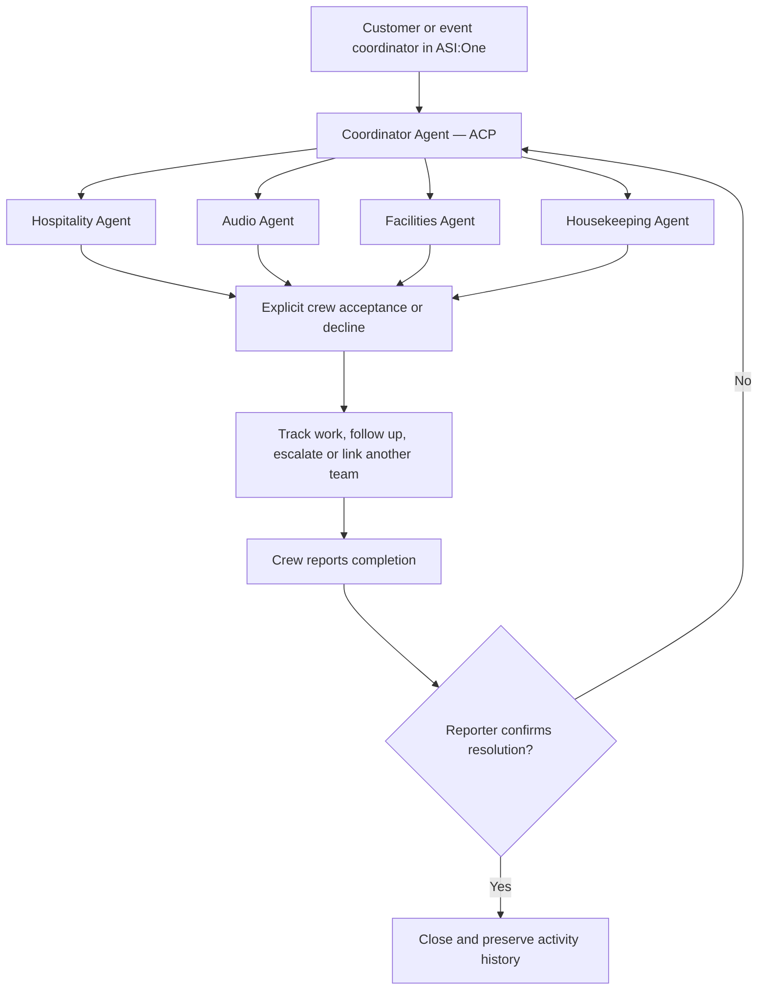

# EventRelay

EventRelay coordinates event-day problems across independent vendor teams. A family member or coordinator reports an issue in ASI:One; the system clarifies it, contacts the responsible team, records explicit acceptance, follows up, escalates failed handoffs, and closes only after the reporter or organizer confirms resolution.


**[Try EventRelay in ASI:One](https://asi1.ai/ai/agent1qw8wdau552av7vc7u0cgc4te3skntynvwkxay8244u995xcd67m32tjqmzu)** · [Public repository](https://github.com/sibiselvam2027-cpu/eventrelay-fetchathon) · [CI results](https://github.com/sibiselvam2027-cpu/eventrelay-fetchathon/actions/workflows/tests.yml)

**27 October 2026 update:** 144 local tests pass, and all five hosted builds compile. The coordinator normalizes known venue aliases such as Main Stage, records authorized escalation or a separate review request when no issue reference was supplied, and never guesses the target incident. Four specialist agents now answer specific public questions while preserving trusted crew controls. Storage guards prevent unchanged reads from rewriting snapshots and reject visibly stale changed sessions before dispatch. The coordinator's unchanged five-question evaluation reached **80%, 4/5 passed**; specialist results and remaining limits are recorded in the [rating and evaluation review](docs/RATING_IMPROVEMENTS.md). A 4.5 profile rating has not been achieved.

**Organizer update shared with the team, 24 October:** the announcement reported ASI:One downtime, extended submission to **11:59 PM IST today**, and recommended **Agent Profile → Testing → Manual Testing** in Agentverse. This records the supplied announcement, not an independent service-wide availability measurement. A later clean ASI:One web workflow completed as documented below; [Public shared-chat evidence](https://asi1.ai/shared-chat/69fc8518-55f8-4b17-bd88-59988ba627f7) is now available.

**Verified status, 24 October 2026:** all five hosted agents started and registered. Actual hosted rehearsals closed synthetic water, audio, power, and cleanup incidents by **16:25:07 IST**. Water included primary decline and backup acceptance; audio included same-issue reopening and reacceptance. A live natural-language status query returned the stored closed water issue. Staff decisions, physical work, and reporter actions were explicitly synthetic. [Live hosted workflow proof](docs/LIVE_WORKFLOW_PROOF.md)

**Native Manual Testing workflow completed at 17:55:05 IST:** incident **ER-3CC6223A** passed through the guided category/location form, automatic vendor decline/backup acceptance, native Start/Done, awaiting confirmation, native reopening under the same ID, reacceptance, and native reporter-confirmed closure. The presenter never clicked Accept. [Sanitized Manual Testing proof](docs/MANUAL_TESTING_PROOF.md)

**Submission video:** the team will provide the final **3–5 minute video and its accessible URL** separately. That submission item remains pending.

**Complete primary ASI:One web workflow verified at approximately 18:44 IST:** a clean audio report created **ER-4DE240CA**, correctly interpreted Audio/Stage, reached actual vendor-agent acceptance by Ravi, progressed to completion, reopened under the same ID, and closed only after the original reporter's confirmation. The flow used native cards and text commands. Rendering delays and one stale-action warning occurred; physical work and vendor policies were synthetic. [Sanitized web proof](docs/ASI_WEB_PROOF.md)

**Start with the [availability and workflow guide](docs/QUICK_DEMO.md).** The live roster persists across rehearsals and evaluations. Send `roster` and ask for the open-issue overview before starting a new incident. Choose a service with available crew or continue an existing issue; unavailable capacity should escalate honestly. [View the public ASI:One workflow](https://asi1.ai/shared-chat/69fc8518-55f8-4b17-bd88-59988ba627f7).

The latest code uses the documented OpenAI-compatible SDK client for ASI1 and provides a clearly labelled **manual guided form inside ASI:One** when ASI1 is unavailable. This recovery requires the user to supply the category and location; it does not claim successful AI reasoning. The fresh web attempt rendered and submitted that form before the issue was offered and accepted; this does not establish the later web steps or LLM extraction.

On the deployed 83-test revision, an **18:28 IST Agentverse Manual Testing** request, **“show status of ER-A50BFBB4”**, returned the actual closed water incident, Neha, and a native status card without manual/offline-parser labels. That phrasing uses live ASI1 intent extraction rather than the explicit command parser. It verifies this current API-backed status lookup, not the ASI:One web interface or every natural-language intent.

The linked CI result verifies source commit `3e96df2b4dde0fbede5e671ef53d6a2b1410c2b2`, with **83 local and CI tests passed**, hosted builds/compilation, and the synthetic scenario. It includes routing-prefix/native-JSON handling, documented colon-note commands, an 18-second SDK request budget within a 20-second intent budget, and safe failure diagnostics. Sender-derived authorization remains unchanged. Source tests and earlier hosted rehearsals remain distinct from the completed primary ASI:One web demonstration linked above. See [deployment evidence](docs/LIVE_DEPLOYMENT.md) and [the submission checklist](docs/SUBMISSION_CHECKLIST.md).

## Review links and submitted agents

[Public ASI:One shared chat](https://asi1.ai/shared-chat/69fc8518-55f8-4b17-bd88-59988ba627f7) · [PowerPoint](docs/EventRelay-pitch.pptx) · [Testing guide](docs/QUICK_DEMO.md) · [Submission packet](docs/SUBMISSION_PACKET.md)

The shared viewer contains the completed **ER-4DE240CA Audio/Stage** sequence from approximately **18:32–18:44 IST on 24 October 2026**. It also retains earlier debugging and demonstration records. Use that incident ID to follow the report, acceptance, work, reopening, and reporter-confirmed closure.

| Agent | Deployed address | Agentverse |
|---|---|---|
| EventRelay Coordinator | `agent1qw8wdau552av7vc7u0cgc4te3skntynvwkxay8244u995xcd67m32tjqmzu` | [Profile](https://agentverse.ai/agents/details/agent1qw8wdau552av7vc7u0cgc4te3skntynvwkxay8244u995xcd67m32tjqmzu/profile) |
| EventRelay Hospitality | `agent1qfrq6l9ta28f4xwn5twktttqns0fczgu3ueghkksrl900j6yl4v6ukxs3ng` | [Profile](https://agentverse.ai/agents/details/agent1qfrq6l9ta28f4xwn5twktttqns0fczgu3ueghkksrl900j6yl4v6ukxs3ng/profile) |
| EventRelay Audio | `agent1qga2l6uypaq0ks2sjl4e2jak650naa0dljznq5kxg34jfs2fsvjnq4da69d` | [Profile](https://agentverse.ai/agents/details/agent1qga2l6uypaq0ks2sjl4e2jak650naa0dljznq5kxg34jfs2fsvjnq4da69d/profile) |
| EventRelay Facilities | `agent1qvxj23fgwdjncysveppxwmzx8yhx5rf9a6ssclxzk56ftj9gyfsgvxh8xkx` | [Profile](https://agentverse.ai/agents/details/agent1qvxj23fgwdjncysveppxwmzx8yhx5rf9a6ssclxzk56ftj9gyfsgvxh8xkx/profile) |
| EventRelay Housekeeping | `agent1qgm0yx34j7qjcqnhjdpvftlwv295cdd0hlysrkqc0tp4zwxn70s0scfct3w` | [Profile](https://agentverse.ai/agents/details/agent1qgm0yx34j7qjcqnhjdpvftlwv295cdd0hlysrkqc0tp4zwxn70s0scfct3w/profile) |

Each hosted agent README carries the Innovation Lab and hackathon badges. A fresh ASI:One recipient search found the coordinator by name and exact address, followed by a successful new-conversation `help` at **19:59 IST** and `roster` at **20:00 IST**. Availability can change between rehearsals.

## Architecture

Five direct uAgents run as **Agentverse Hosted Agents**. **ASI:One is the intended product interface**. Forms and status/confirmation cards are declared through ACP; there is no custom website, frontend, LangChain, MCP adapter, or separate database service. The organizer-recommended Agentverse Manual Testing panel is a demonstration/testing alternative during the reported ASI:One disruption, not an additional product frontend.



The hospitality agent handles drinking-water refill issues; audio handles microphones and speakers; facilities handles power and lighting; housekeeping handles cleanup. Each has its own identity and message handlers. The coordinator owns the issue lifecycle. Message delivery is **not** worker acceptance, and crew completion is **not** verified closure.

## Repository map

- `eventrelay/store.py`: deterministic issue state machine, responsibilities, reservations, deadlines, dependencies, and audit history.
- `eventrelay/router.py`: clarification, authorized actions, conversation state, and ASI native cards.
- `eventrelay/asi.py`: ASI1 intent extraction; model output never establishes staff identity or authority.
- `eventrelay/hosted_state.py`: durable Agent Storage checkpoint adapter for hosted invocations.
- `eventrelay/hosted_runtime.py`: hosted ACP and agent-to-agent handlers, persistent offers, retries, and follow-up sweep.
- `hosted/`: generated multi-file deployment projects, one per hosted agent.
- `eventrelay/fetch_agents.py`: direct-uAgents local transport harness for development and testing; this is not the hosted deployment.
- `tests/`: workflow, authorization, replay, transport, persistence, and ASI client tests.
- `docs/BUSINESS_MODEL.md`, `docs/COMPETITION.md`, `docs/DEMO.md`: business assumptions, judging story, and demo script.

## Run the tests locally

Use Python **3.10–3.13**; the verified local environment is Python 3.12.14. Python 3.14 is not the supported tutorial path.

```powershell
py -3.12 -m venv .venv
.\.venv\Scripts\python -m pip install -r requirements.txt
.\.venv\Scripts\python -m unittest discover -s tests -v
.\.venv\Scripts\python -m eventrelay.demo
```

The deterministic demo uses synthetic people and simulated physical work. It produces actual issue transitions and assertions, not a claim that an event was serviced. `data/demo-proof.json` is generated locally and excluded from Git.

The optional local command console (`python -m eventrelay.cli`) is a development tool, not a required product frontend. The submitted user workflow must be tested inside ASI:One.

## Deploy to Agentverse

```powershell
python build_hosted.py
avctl auth login
cd hosted
avctl hosting init --workspace
avctl hosting deploy
```

Each role is a separate hosted project with `agent.py`, `pyproject.toml`, sibling Python modules, and `.env.example`. AVCTL workspace initialization records the five projects. Configure the actual public agent addresses and private credentials in Agent Secrets. Initial deployment creates addresses; configure their cross-agent addresses, then redeploy the existing agents. Do not use circular address-template dependencies in the first deployment.

Only the coordinator needs `ASI1_API_KEY`. Native structured commands/cards can be tested without it, but live natural-language reasoning must be verified with ASI1 before claiming it works. Never put an API key, private seed, authentication token, runtime database, or `.env` into this repository.

Hosted agents reset global variables between invocations. Durable state is checkpointed through Agent Storage, before sending downstream messages. The prototype assumes one coordinator processes state mutations serially; it is not a claim of distributed compare-and-swap storage or production-scale transactions.

Registration is only one step. Complete profiles/README, enable ACP, start every agent, verify discovery from ASI:One, then demonstrate the complete flow. Record the five Agentverse profile URLs and a public ASI:One shared chat only after those checks succeed.

## Business model

The buyer is an event-planning agency or venue operator. Family members report issues and vendor crews act on them. Start with a per-event pilot, then test an agency subscription with reusable vendor rosters and repeated events. Pricing is an unvalidated hypothesis; see `docs/BUSINESS_MODEL.md` for costs, adoption risks, and a small field-validation plan.

Measure time to an accepted owner, time an issue remains unowned, manual follow-up touches, and reopened issues. Do not count a delivered message as a resolved problem.

## Review and submission status

The primary Audio/Stage workflow is verified through ASI:One web, including live intent extraction, actual vendor-agent acceptance, same-ID reopening, and reporter-confirmed closure. Complete Agentverse Manual Testing and four-category hosted rehearsals provide separate evidence. The public shared-chat viewer is verified. The team video and final submission receipt remain pending; further language/clarification cases and real-world outcomes are not implied. All live proof uses explicitly synthetic staff and reporter actions.

The bundled event is synthetic. Real deployments require event-specific staff identities and responsibility mappings. Automatic demo responses are explicitly labelled; production mode requires authenticated staff responses. No WhatsApp, phone, or real-world repair integration is claimed.

## References

- [uAgents source](https://github.com/fetchai/uAgents)
- [uAgent creation and hosting modes](https://innovationlab.fetch.ai/resources/docs/agent-creation/uagent-creation)
- [ASI:One Interactive Cards](https://innovationlab.fetch.ai/resources/docs/interactive-cards/asi-interactive-cards)
- [Fetch-A-Thon 3.0 hackpack](https://www.fetch.ai/events/hackathons/fetch-a-thon-3/hackpack)
- [Hosted Agents](https://docs.agentverse.ai/documentation/create-agents/hosted-agents)
- [Hosted multi-file editor](https://docs.agentverse.ai/documentation/create-agents/hosted-code-editor)
- [Agentverse CLI](https://docs.agentverse.ai/documentation/advanced-usages/agentverse-cli)
