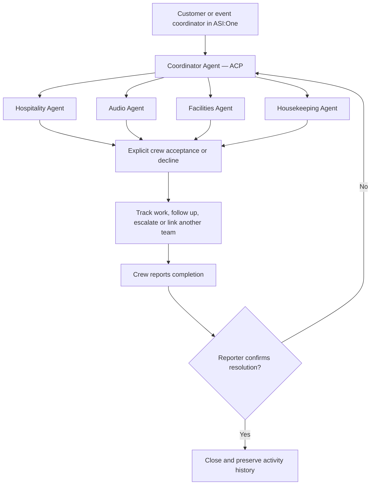

# EventRelay

EventRelay coordinates event-day problems across independent vendor teams. A family member or coordinator reports an issue in ASI:One; the system clarifies it, contacts the responsible team, records explicit acceptance, follows up, escalates failed handoffs, and closes only after the reporter or organizer confirms resolution.


## Architecture

Five direct uAgents run as **Agentverse Hosted Agents**. **ASI:One is the only product interface**. Forms and status/confirmation cards are declared through ACP; there is no custom website, frontend, LangChain, MCP adapter, or separate database service.



The hospitality agent handles drinking-water refill issues; audio handles microphones and speakers; facilities handles power and lighting; housekeeping handles cleanup. Each has its own identity and message handlers. The coordinator owns the issue lifecycle. Message delivery is **not** worker acceptance, and crew completion is **not** verified closure.

## Repository map

- `eventrelay/store.py`: deterministic issue state machine, responsibilities, reservations, deadlines, dependencies, and audit history.
- `eventrelay/router.py`: clarification, authorized actions, conversation state, and ASI native cards.
- `eventrelay/asi.py`: ASI1 intent extraction; model output never establishes staff identity or authority.
- `eventrelay/hosted_state.py`: durable Agent Storage checkpoint adapter for hosted invocations.
- `eventrelay/hosted_runtime.py`: hosted ACP and agent-to-agent handlers, persistent offers, retries, and follow-up sweep.
- `hosted/`: generated multi-file deployment projects, one per hosted agent.
- `eventrelay/fetch_agents.py`: direct-uAgents local transport harness for development and testing; this is not the hosted deployment.
- `tests/`: workflow, authorization, replay, transport, persistence, and ASI client tests.
- `docs/BUSINESS_MODEL.md`, `docs/COMPETITION.md`, `docs/DEMO.md`: business assumptions, judging story, and demo script.

## Run the tests locally

Use Python **3.10–3.13**; the verified local environment is Python 3.12.14. Python 3.14 is not the supported tutorial path.

```powershell
py -3.12 -m venv .venv
.\.venv\Scripts\python -m pip install -r requirements.txt
.\.venv\Scripts\python -m unittest discover -s tests -v
.\.venv\Scripts\python -m eventrelay.demo
```

The deterministic demo uses synthetic people and simulated physical work. It produces actual issue transitions and assertions, not a claim that an event was serviced. `data/demo-proof.json` is generated locally and excluded from Git.

The optional local command console (`python -m eventrelay.cli`) is a development tool, not a required product frontend. The submitted user workflow must be tested inside ASI:One.

## Deploy to Agentverse

```powershell
python build_hosted.py
avctl auth login
cd hosted
avctl hosting init --workspace
avctl hosting deploy
```

Each role is a separate hosted project with `agent.py`, `pyproject.toml`, sibling Python modules, and `.env.example`. AVCTL workspace initialization records the five projects. Configure the actual public agent addresses and private credentials in Agent Secrets. Initial deployment creates addresses; configure their cross-agent addresses, then redeploy the existing agents. Do not use circular address-template dependencies in the first deployment.

Only the coordinator needs `ASI1_API_KEY`. Native structured commands/cards can be tested without it, but live natural-language reasoning must be verified with ASI1 before claiming it works. Never put an API key, private seed, authentication token, runtime database, or `.env` into this repository.

Hosted agents reset global variables between invocations. Durable state is checkpointed through Agent Storage, before sending downstream messages. The prototype assumes one coordinator processes state mutations serially; it is not a claim of distributed compare-and-swap storage or production-scale transactions.

Registration is only one step. Complete profiles/README, enable ACP, start every agent, verify discovery from ASI:One, then demonstrate the complete flow. Record the five Agentverse profile URLs and a public ASI:One shared chat only after those checks succeed.

## Business model

The buyer is an event-planning agency or venue operator. Family members report issues and vendor crews act on them. Start with a per-event pilot, then test an agency subscription with reusable vendor rosters and repeated events. Pricing is an unvalidated hypothesis; see `docs/BUSINESS_MODEL.md` for costs, adoption risks, and a small field-validation plan.

Measure time to an accepted owner, time an issue remains unowned, manual follow-up touches, and reopened issues. Do not count a delivered message as a resolved problem.

## Review and submission status

Code and local test evidence are available in this repository. Hosted runtime validation, Agentverse deployment, ASI:One discovery, shared-chat evidence, and the demo video must each be verified separately. A local test or successful upload does not establish live availability.

The bundled event is synthetic. Real deployments require event-specific staff identities and responsibility mappings. Automatic demo responses are explicitly labelled; production mode requires authenticated staff responses. No WhatsApp, phone, or real-world repair integration is claimed.

## References

- [uAgents source](https://github.com/fetchai/uAgents)
- [uAgent creation and hosting modes](https://innovationlab.fetch.ai/resources/docs/agent-creation/uagent-creation)
- [ASI:One Interactive Cards](https://innovationlab.fetch.ai/resources/docs/interactive-cards/asi-interactive-cards)
- [Fetch-A-Thon 3.0 hackpack](https://www.fetch.ai/events/hackathons/fetch-a-thon-3/hackpack)
- [Hosted Agents](https://docs.agentverse.ai/documentation/create-agents/hosted-agents)
- [Hosted multi-file editor](https://docs.agentverse.ai/documentation/create-agents/hosted-code-editor)
- [Agentverse CLI](https://docs.agentverse.ai/documentation/advanced-usages/agentverse-cli)
