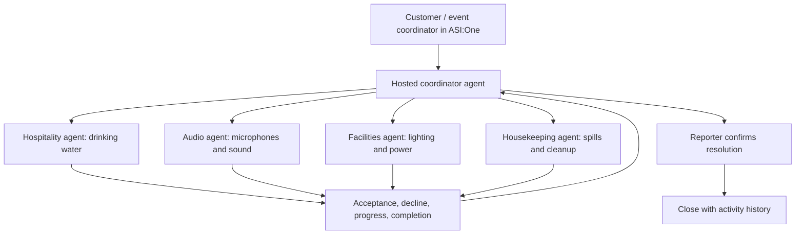

# EventRelay

**Report an event problem once. Give it an accountable owner. Track it until resolution is confirmed.**

## The problem

A wedding brings together a temporary team: the family, planner, venue, caterer, AV vendor, housekeeping crew, and facilities staff. They work for different people and have different responsibilities. When something goes wrong, the coordinator must identify the right team, explain the issue, find someone available, chase a response, and tell the customer what happened.

“There is a water issue” exposes the difficulty. Empty drinking-water dispensers belong to catering; a spill belongs to housekeeping; a leaking tap belongs to venue facilities. Forwarding the complaint to the first plausible person can leave it without a real owner.

EventRelay is an AI-assisted dispatcher for the event day. The initial buyer hypothesis is an event-planning agency or venue operator. Family representatives, coordinators, and crew use the workflow.

## The proposed POC

The POC covers one synthetic wedding, four issue categories, and eight demonstration staff members:

| Issue | Responsible function | Primary / backup |
|---|---|---|
| Drinking-water refill | Hospitality | Arun / Neha |
| Microphone or audio fault | AV | Ravi / Sara |
| Spill or cleanup | Housekeeping | Meena / Kiran |
| Lighting or power concern | Venue facilities | Vikram / Pooja |

The event-specific responsibility roster controls routing. The agent asks a short question when the category or location is unclear. It records a task, offers it to an eligible available person, and obtains an explicit acceptance. A delivered message or protocol acknowledgment is insufficient.

The lifecycle is:

**Reported → Offered → Accepted → In progress → Awaiting confirmation → Closed**

Declines and offer timeouts trigger the approved backup. Exhausted options leave the issue visibly escalated to the organizer. A crew-reported completion is separate from the reporter's confirmation. A negative confirmation reopens the same issue and preserves its history.

For work spanning teams, linked tasks express dependencies. A parent task must not be completed while a required dependency remains open. The software coordinates qualified people; it does not diagnose electrical faults or declare a physical area safe.

## Why agents are useful here

The approved architecture contains **five Agentverse Hosted Agents**: one coordinator and four vendor agents for hospitality, audio, facilities, and housekeeping. ASI:One is the sole user interface. The agents use direct uAgents, ACP for conversational interaction, and typed uAgent messages between vendors and the coordinator. Each vendor represents a separate service team and its acceptance or availability constraints. Human staff actions or clearly labelled demo policies supply the actual decisions.

The complete demonstration stays inside ASI:One. Task creation, offers, acceptance, follow-up, escalation, and closure must be persistent operations rather than generated descriptions. Agentverse's hosted runtime resets global variables between invocations; the hosted design therefore stores workflow and routing state in Agent Storage. The hosted editor supports modules across multiple files and provides Agent Secrets for credentials. [Hosted Agents](https://docs.agentverse.ai/documentation/create-agents/hosted-agents), [Hosted Code Editor](https://docs.agentverse.ai/documentation/create-agents/hosted-code-editor)

Hosted implementation, live message exchange, deployment, and ASI:One discoverability remain pending until separately verified. Using uAgents or creating a hosted agent does not by itself prove the complete flow is registered, searchable, and usable. The local verification baseline uses Python 3.12 and uAgents 0.25.5; the hosted environment and allowed imports must be checked before deployment.

## Competition proof

The official rubric weights functionality at 25%, Fetch.ai technology at 20%, innovation at 20%, usefulness at 20%, and presentation at 15%. The submission requires an Agentverse agent, ACP, ASI:One usability, meaningful execution, a public repository, an ASI shared chat, agent-profile links, and a short demonstration video. [Official hackpack](https://www.fetch.ai/events/hackathons/fetch-a-thon-3/hackpack)

The clearest proof is a declined offer followed by backup acceptance, worker completion, reporter rejection, and eventual confirmed closure. Show the unchanged issue ID and complete activity history. Demonstrate that an unauthorized staff member cannot accept another person's offer or close a customer's issue.

## Positioning and validation

Event incident management already exists. [Halo](https://www.halosolutions.com/) covers incidents, tasks, teams, and locations; [All Things Wed](https://allthingswed.com/) offers Indian wedding planners connected operational tools. EventRelay's proposed focus is conversational coordination across temporary vendors, explicit acceptance, failed-handoff recovery, and reporter-confirmed resolution. This is a focus to validate, not a claim of being the first event-management product.

The business-model hypothesis is a per-event paid pilot followed by a monthly agency or venue subscription. Family reporters and crew use the service; the planner or venue is the proposed buyer. Pricing, adoption, and willingness to pay remain unvalidated. See [the business-model review](BUSINESS_MODEL.md).

The first validation plan is three planner interviews, one venue interview, and one observed field pilot. Reconstruct actual incidents and compare the pilot with the current process. Check whether event-specific responsibility, escalation authority, and staff participation match practice.

Measure **time to accountable acceptance**, **minutes without an owner**, **manual follow-ups**, and **reopened issues**. Compare those against the planner's existing process before claiming time savings.

## Scope and evidence boundary

This brief describes the intended hosted POC. Verify its code, persistence, deployment, and live ASI:One behavior before describing it as complete. The user interface is ASI:One, with native cards where supported; the approved agent implementation has no custom frontend, LangChain, or MCP dependency. Staff, event details, and physical repairs are demonstration data unless real participants operate them. WhatsApp messaging, phone calls, speech input, payments, and verified real-world repair completion must not be presented as implemented without evidence.
